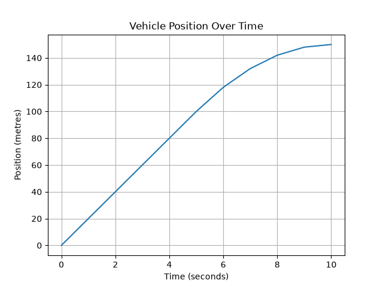
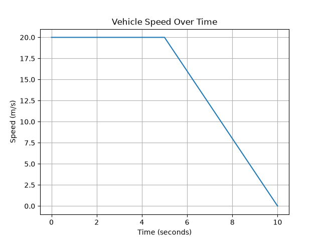
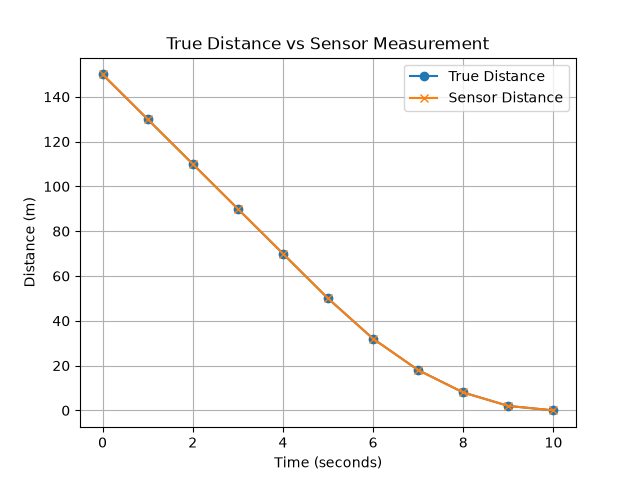

# Sensor-Aware Autonomous Car

A Python-based simulation of a vehicle that monitors distance-sensor measurements, detects abnormal sensor behaviour, and activates safety braking when necessary.

## Overview

Autonomous vehicles depend on sensors to understand their surroundings. However, sensor measurements can become incorrect, frozen, or unreliable.

This project simulates a simple vehicle approaching a stationary obstacle. The system compares the measured sensor distance with an expected distance, detects suspicious measurements, and uses a safety controller to slow down and stop the vehicle.

The simulation includes vehicle motion, distance sensing, fault injection, fault detection, safety braking, and visualization of the results.

## System Architecture

The simulation follows a simple closed-loop structure:

```text
Vehicle Model
     ↓
True Distance to Obstacle
     ↓
Distance Sensor
     ↓
Sensor Measurement
     ↓
Fault Detection
     ↓
Safety Controller
     ↓
Braking Command
     ↓
Vehicle Model
```

The vehicle model calculates the vehicle's position and speed. The simulated distance sensor measures the distance between the vehicle and the obstacle.

The fault-detection system compares the sensor measurement with an expected measurement. If an abnormal measurement or a stuck sensor is detected, the safety controller commands braking.

## How the Simulation Works

### 1. Vehicle Motion

The vehicle starts with an initial speed of 20 m/s and moves toward a stationary obstacle located 150 m ahead.

The vehicle speed is updated using:

`v_new = v_old + a × Δt`

where:

- `v` is the vehicle speed
- `a` is the acceleration
- `Δt` is the simulation time step

The vehicle position is updated using the average speed during each simulation step.

### 2. Distance Sensor

The simulated sensor measures the distance between the vehicle and the obstacle:

`distance = obstacle_position - vehicle_position`

Under normal conditions, the sensor measurement is equal to the true distance.

For testing purposes, incorrect sensor measurements can be injected into the simulation.

### 3. Expected Sensor Measurement

The system calculates an expected sensor distance based on the previous accepted sensor measurement and the current vehicle motion.

A simplified prediction is used:

`expected_distance = previous_sensor_distance - speed × Δt`

This expected value provides a reference that can be compared with the actual sensor measurement.

### 4. Residual-Based Fault Detection

The difference between the sensor measurement and the expected measurement is called the residual:

`residual = |sensor_measurement - expected_measurement|`

If the residual becomes larger than the configured fault threshold, the sensor measurement is considered suspicious.

The current simulation uses a fault threshold of 30 m.

### 5. Stuck-Sensor Detection

A sensor can also fail by repeatedly reporting the same value while the vehicle continues to move.

The simulation therefore monitors consecutive identical sensor measurements.

If the distance measurement remains unchanged while the vehicle is moving, the system flags the measurement as suspicious.

This additional check was introduced after testing showed that residual-based detection alone could miss a frozen sensor.

### 6. Safety Controller

The controller calculates the approximate physical stopping distance of the vehicle:

`stopping_distance = v² / (2 × |a_brake|)`

The simulation uses a braking acceleration of:

`-4 m/s²`

A safety margin of 10 m is added:

`safe_stopping_distance = stopping_distance + safety_margin`

Braking is activated when:

- a sensor fault is detected, or
- the measured obstacle distance becomes smaller than or equal to the safe stopping distance.

## Simulation Parameters

| Parameter | Value |
|---|---:|
| Initial position | 0 m |
| Initial speed | 20 m/s |
| Obstacle position | 150 m |
| Time step | 1 s |
| Braking acceleration | -4 m/s² |
| Residual fault threshold | 30 m |
| Safety margin | 10 m |

## Fault Injection

Sensor faults can be introduced directly into the simulation to evaluate the fault-detection system.

For example, a stuck sensor can be simulated using:

```python
if 4 <= second <= 6:
    sensor_distance = 70
```

This causes the sensor to report 70 m repeatedly during several simulation steps even though the vehicle continues moving toward the obstacle.

The fault injection is commented out by default so that the program runs under normal sensor conditions.

## Test Scenarios

Several scenarios were used during development.

### Test 1 — Large Distance Error

The true obstacle distance was approximately 50 m while the simulated sensor incorrectly reported 250 m.

Result:

- A large residual was generated.
- The fault detector identified the measurement as suspicious.
- Safety braking was activated.

### Test 2 — Small False Distance

The true obstacle distance was approximately 50 m while the simulated sensor incorrectly reported 5 m.

Result:

- The residual exceeded the configured threshold.
- The measurement was detected as suspicious.
- The controller activated braking.

### Test 3 — Stuck Sensor

The sensor was forced to remain at 70 m for multiple simulation steps while the vehicle continued moving.

Initial testing showed an important limitation: residual-based detection alone did not identify the fault early enough.

A stuck-sensor check was therefore added. After this improvement, the frozen measurement was detected earlier and the vehicle was able to brake before passing the obstacle in the simulated scenario.

### Test 4 — Normal Operation

The simulation was also tested without injecting any sensor fault.

Result:

- No false sensor warnings were generated.
- The controller calculated the stopping distance as the vehicle approached the obstacle.
- The vehicle decelerated from 20 m/s to 0 m/s.
- The simulated vehicle stopped at the obstacle position.

## Visualization

The simulation generates three plots using Matplotlib.

### Vehicle Position Over Time

This plot shows how the vehicle position changes as it approaches the obstacle and brakes.



### Vehicle Speed Over Time

This plot shows the vehicle speed and the effect of the safety braking controller.



### True Distance vs Sensor Measurement

This plot compares the actual distance to the obstacle with the simulated sensor measurement.

During normal operation, both values closely follow each other. During an injected sensor fault, the difference becomes visible.



## Technologies Used

- Python
- Matplotlib
- Visual Studio Code

## Project Structure

```text
Sensor-Aware-Autonomous-Car/
│
├── car_simulation.py
└── README.md
```

`car_simulation.py` contains the vehicle model, sensor simulation, fault-detection logic, safety controller, testing logic, and visualization.

`README.md` documents the system architecture, equations, test scenarios, and results.

## How to Run

### 1. Install Python

Python 3 is required.

### 2. Install Matplotlib

Run:

```bash
python -m pip install matplotlib
```

### 3. Run the Simulation

From the project directory:

```bash
python car_simulation.py
```

The simulation prints the sensor and vehicle information in the terminal and displays the result plots.

## What I Learned

This project was developed as an introduction to simulation, sensor monitoring, and safety-oriented control logic.

Through the project, I practiced:

- implementing a simple vehicle-motion model
- working with position, velocity, acceleration, and time steps
- simulating distance-sensor measurements
- injecting artificial sensor faults
- comparing measured and expected sensor behaviour
- using residuals for basic fault detection
- detecting a frozen sensor
- calculating vehicle stopping distance
- implementing rule-based safety braking
- testing normal and faulty operating conditions
- visualizing simulation results with Python

## Limitations

This project is intentionally a simplified prototype.

Current limitations include:

- one-dimensional vehicle motion
- one stationary obstacle
- fixed 1-second simulation time step
- simplified vehicle dynamics
- ideal sensor measurements under normal conditions
- manually injected sensor faults
- fixed fault-detection thresholds
- simplified stuck-sensor detection
- no sensor-noise model
- no steering or path planning
- no advanced state estimation

The expected-sensor model is also intentionally simple and can produce inaccurate predictions after several rejected sensor measurements.

## Future Improvements

Possible future extensions include:

- smaller simulation time steps
- realistic sensor noise
- multiple sensor types
- improved fault-recovery logic
- adaptive fault thresholds
- state estimation
- PID-based control
- multiple obstacles
- steering and lateral vehicle dynamics
- integration with simulation environments such as CARLA
- ROS 2 integration

## Purpose

The goal of this project is not to reproduce a complete autonomous-driving system.

Instead, it demonstrates the basic engineering relationship between:

**vehicle dynamics → sensing → fault detection → safety control → vehicle response**

It serves as a foundation for future projects in autonomous systems, vehicle simulation, sensor fusion, and control engineering.

[def]: results/sensor_comparison.png